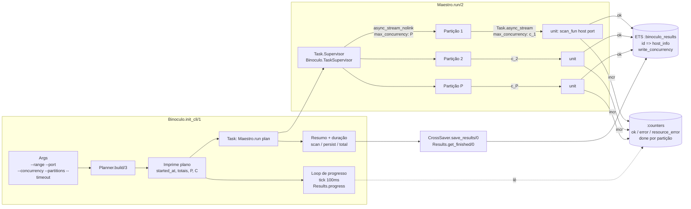
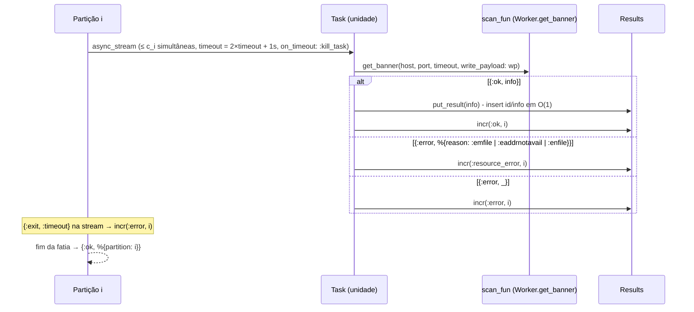
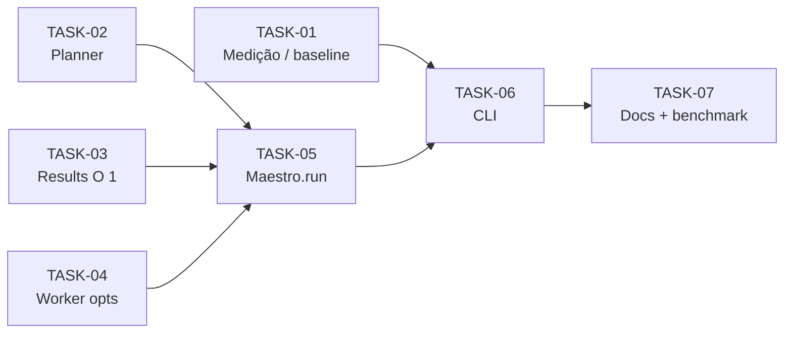

# Implementation Plan: Scan paralelo particionado (chunked) com agregação eficiente de resultados

SPEC: [parallel_chunked_scan_spec.md](../specs/parallel_chunked_scan_spec.md)

## 1. Approach summary

A implementação reaproveita o `Worker.get_banner/3`, o formato de saída do `CrossSaver` e a lib `net_address`. Os gargalos D1–D9 são eliminados em quatro frentes:

1. **Medição primeiro.** Início, fim e duração das fases de scan e de persistência são entregues antes de qualquer mudança no motor, para capturar a baseline.
2. **Planner puro.** Um módulo novo calcula `total_hosts × ports` e as partições com aritmética de inteiros. `IP.Subnet` e `IP.Range` já implementam `Enumerable.count/1` e `slice/1` em O(1) (conferido em `net_address` 0.2.2), então nada é materializado.
3. **Execução particionada com concorrência real.** `Maestro.run/2` executa P partições sob um `Task.Supervisor`. Cada partição usa `Task.async_stream` com `max_concurrency` próprio, cuja soma é exatamente C, e o próprio processo da unidade executa o `get_banner`. Não existe mais `cast` nem `handle_info` central.
4. **Store de resultados O(1).** `Results` passa a guardar uma linha ETS por resultado (`{id, host_info}`) e usa `:counters` para progresso. O progresso lê apenas os contadores.

Áreas afetadas: `lib/binoculo.ex` (CLI), `lib/binoculo/{args,maestro,results,worker,util,application,config}.ex`, um módulo novo `lib/binoculo/planner.ex`, os testes, o `README.md`, o script `binoculo` e o `mix.exs` (`emu_args` do escript).

Diagnóstico adicional encontrado no planejamento (complementa a SPEC):

- **D9:** `Worker.send_payload/3` chama `Config.get_write_payload/0` (um `GenServer.call`) **por unidade**, mais um ponto serializado.
- **D10:** `Worker.get_banner/3` não fecha o socket. Hoje ele só é liberado quando o processo da task morre.

## 2. Technical alternatives

### Alternative A: um único `Task.async_stream` global (sem partições)

Um stream lazy de unidades `→ Task.async_stream(max_concurrency: C)`, em que cada task grava direto no ETS.

Pros:
- O mais simples. Resolve D1, D2, D3, D5, D6 e D7 com pouquíssimo código.
- Com C = 5000 e ~2–4s por unidade, o consumidor do stream recebe ~1.500–2.500 mensagens/s, um volume tranquilo para um processo só.

Cons:
- Não atende a SPEC no isolamento de falhas por partição nem no plano P exibido.
- Continua tendo um único processo consumidor. Se a latência por unidade cair (rede local com RST rápido), ele volta a ser o gargalo.

### Alternative B: P partições, cada uma com seu `Task.async_stream` (escolhida)

`Task.Supervisor.async_stream_nolink(partições, max_concurrency: P)`. Cada partição roda `Task.async_stream(slice, max_concurrency: c_i)`, com `Σ c_i = C`.

Pros:
- Atende a SPEC: plano P, balanceamento ±1, crash isolado (`async_stream_nolink` devolve `{:exit, reason}` para a partição que caiu) e contagem de `not_processed`.
- Distribui o consumo de mensagens em P processos.
- Com P = 1 o comportamento equivale à Alternativa A, o que facilita o teste de equivalência.

Cons:
- Um nível a mais de processos e o cálculo de `c_i`. A complexidade continua baixa.

### Alternative C: `Flow` / `GenStage` / `Broadway`

Pros:
- Particionamento e back-pressure prontos.

Cons:
- Dependência nova para algo que `Task.async_stream` já resolve. Overengineering para uma CLI de execução única.

### Chosen approach

A **Alternativa B**, porque é o menor passo que cumpre a SPEC inteira usando só OTP/Elixir padrão, sem dependência nova. O motor recebe a função de scan injetável (`scan_fun`, com default `&Worker.get_banner/3`), o que permite testar concorrência máxima e crash de partição de forma determinística.

## 3. Solution design

### Componentes



### Planner: aritmética das partições

- `first_int = IP.to_integer(first_ip)`. `total_hosts` vem de `Enum.count(range)`, que é O(1) pelo `Enumerable` do `net_address`.
- `ports_t = List.to_tuple(ports)`, `n_ports = tuple_size(ports_t)`, `total_units = total_hosts * n_ports`.
- `p_eff = min(P, total_units, C)`.
- Partição `i` (0-based): `base = div(N, p_eff)`, `r = rem(N, p_eff)`, `start = i * base + min(i, r)`, `len = base + (if i < r, do: 1, else: 0)`.
- A concorrência `c_i` é dividida da mesma forma (`div(C, p_eff)` + resto), garantindo `Σ c_i == C`.
- Unidade `u` vira `{IP.from_integer(first_int + div(u, n_ports), :v4) |> IP.to_string(), elem(ports_t, rem(u, n_ports))}`. A ordem é host-major (as portas do mesmo host ficam adjacentes).
- Cada partição gera seus alvos com `Stream.map(start..(start + len - 1), &unit_to_target/2)`, tudo lazy.

### Execução de uma unidade (dentro da task)



- **Id do documento:** `put_result/1` calcula `:crypto.hash(:md5, "#{host} <> #{port}") |> Base.encode16()`, a mesma string usada hoje em `Maestro.handle_info/2`, incluindo o literal ` <> `. Isso preserva o contrato com o Meilisearch.
- **`write_payload`:** é lido uma vez do `Config` no `Maestro.run/2` e passado nos opts (resolve D9).
- **`not_processed`** de uma partição que caiu é `len_i - done_i`, com `done_i` vindo do slot de contador da partição.

## 4. Implementation tasks

### TASK-01: Medição de tempo (baseline) e fuso horário no Docker. Complexity: S

**Goal**

Exibir `started_at`, `finished_at` e as durações (scan, persistência, total), além de unidades/s, **com o motor atual**, para registrar a baseline.

**Likely files**

- `lib/binoculo/util.ex`: modificar (`format_duration/1`, `format_datetime/1`)
- `lib/binoculo.ex`: modificar (`init_cli/1`)
- `binoculo` (script): modificar (montar `/etc/localtime`)
- `test/util_test.exs`: modificar

**Steps**

1. Criar `Util.format_duration(ms)`, com saída como `"850ms"`, `"42.1s"`, `"3m 42.1s"` e `"1h 02m 03.0s"`.
2. Criar `Util.format_datetime/0` (ou `/1`) usando `:calendar.system_time_to_rfc3339(System.os_time(:second))`, que gera ISO 8601 com o offset local.
3. Em `init_cli/1`: guardar `t0 = System.monotonic_time(:millisecond)` e `started_at` antes de `Maestro.start_get_banner_workers/2`, e imprimir `[*] Started at: ...`. Marcar `t_scan_end` depois do spinner e `t_end` depois de `CrossSaver.save_results/0`.
4. Imprimir o resumo com `Finished at`, `Scan`, `Persist`, `Total` e `Rate: N units/s`.
5. No script `binoculo`, adicionar `-v /etc/localtime:/etc/localtime:ro` ao `docker run`. A imagem alpine sai em UTC por padrão, e o musl lê `/etc/localtime`.

**Technical validation**

- [ ] `mix test test/util_test.exs` passa, com testes de `format_duration/1` nas faixas ms, s, m e h.
- [ ] Rodar um scan pequeno (`127.0.0.1`) mostra o horário de início e o resumo com a hora local correta.
- [ ] A saída em `output/` não muda.
- [ ] **Medir a baseline** com o comando de referência da SPEC e preencher a tabela.

### TASK-02: Planner (contagem + particionamento). Complexity: M

**Goal**

Criar um módulo puro que transforma `(host_notation, ports, opts)` em um plano com partições balanceadas e geração lazy de alvos.

**Likely files**

- `lib/binoculo/planner.ex`: criar
- `test/planner_test.exs`: criar

**Steps**

1. Criar `%Binoculo.Planner{}` com os campos `first_int`, `total_hosts`, `ports` (tupla), `total_units`, `partitions` (lista de `%{index, start, len, concurrency}`), `concurrency`, `timeout`.
2. Implementar `build(host_notation, ports, opts)`, que reusa `Util.parse_range_or_cidr_notation/1`, obtém o primeiro IP (`subnet.routing_prefix` ou `range.first`) e a contagem via `Enum.count/1`, que é O(1).
3. Implementar `split(n, p)` (genérico, usado para unidades e para concorrência) e `targets(plan, partition)`, que devolve um `Stream`.
4. Validar `concurrency >= 1`, `partitions >= 1` e `timeout >= 1`, retornando `{:error, reason}`.

**Technical validation**

- [ ] `/16` com 2 portas dá 65.536 hosts e 131.072 unidades.
- [ ] Os casos `/32`, `a..b` e `/0` (4.294.967.296 hosts) são calculados sem alocação proporcional.
- [ ] O balanceamento atende `Σ len == N`, `max - min ≤ 1`, sem sobreposição e cobrindo `0..N-1`.
- [ ] Com `P > N`, `p_eff = N`. Com `P > C`, `p_eff = C`, e `Σ c_i == C`.
- [ ] `targets/2` gera o IP e a porta corretos nas bordas (primeira e última unidade de cada partição).

### TASK-03: Store de resultados O(1) + contadores. Complexity: M

**Goal**

Trocar as listas do ETS por uma linha por resultado e contadores atômicos, mantendo `get_finished/0` para o `CrossSaver`.

**Likely files**

- `lib/binoculo/results.ex`: modificar
- `test/result_test.exs`: modificar

**Steps**

1. Fazer `init_db(n_partitions \\ 1)` (re)criar a ETS `:binoculo_results` (`:set, :public, :named_table, write_concurrency: true`) e criar um `:counters.new(3 + n_partitions, [:write_concurrency])` guardado em `:persistent_term`.
2. Criar a API nova:
   - `put_result/1`, que calcula o `id` (mesma fórmula atual) e faz `:ets.insert`;
   - `incr(kind, partition_index)`, com `kind` em `:ok`, `:error` ou `:resource_error`, que também incrementa `done` da partição;
   - `progress/0`, que retorna `%{done, ok, error, resource_error}`;
   - `partition_done/1`;
   - `get_finished/0`, que devolve os `host_info` via `:ets.select`.
3. **Manter temporariamente** `add_item`, `remove_item`, `get_running` e `get_qty_running` sobre a estrutura antiga, para o projeto continuar compilando até a TASK-05. Elas são removidas na TASK-05.

**Technical validation**

- [ ] `mix test test/result_test.exs test/cross_saver_test.exs` passa.
- [ ] Inserir 100k resultados leva tempo linear. Um teste simples com `:timer.tc` garante que fica abaixo de um limite folgado.
- [ ] O `id` gerado é idêntico ao do `Maestro.handle_info/2` atual.

### TASK-04: Worker com opts, classificação de erro e fechamento de socket. Complexity: S

**Goal**

Remover o `GenServer.call` por unidade (D9), expor o `reason` do erro para contar erros de recurso e fechar o socket (D10), sem quebrar a assinatura atual.

**Likely files**

- `lib/binoculo/worker.ex`: modificar
- `test/worker_test.exs`: modificar

**Steps**

1. Mudar para `get_banner(host, port, timeout \\ :timer.seconds(2), opts \\ [])`. Se `opts` tiver `:write_payload` (inclusive `nil`), usar esse valor. Senão, cair no `Config.get_write_payload/0` (compatibilidade com a API e os testes atuais).
2. Incluir `reason: reason` no mapa de erro (chave nova, não quebra nada, porque erros não são persistidos).
3. Fechar o socket com `:gen_tcp.close/1` após o `recv`, no sucesso e no erro (`after`/`with` + cleanup).

**Technical validation**

- [ ] `mix test test/worker_test.exs` passa sem alterar as asserções existentes.
- [ ] Teste novo: `opts[:write_payload]` tem precedência sobre o `Config`.
- [ ] Teste novo: o erro de porta fechada traz `reason: :econnrefused`.

### TASK-05: Motor particionado (`Maestro.run/2`). Complexity: L

**Goal**

Substituir o fluxo `cast`/`handle_info` por execução particionada com concorrência limitada, isolamento de falhas e término determinístico.

**Likely files**

- `lib/binoculo/maestro.ex`: reescrever (deixa de ser `GenServer`)
- `lib/binoculo/application.ex`: modificar (adicionar `{Task.Supervisor, name: Binoculo.TaskSupervisor}`)
- `lib/binoculo/config.ex`: modificar (remover `start_maestro/0`)
- `lib/binoculo/results.ex`: modificar (remover a API antiga da TASK-03)
- `test/maestro_test.disabled`: remover e substituir por `test/maestro_test.exs`

**Steps**

1. Criar `Maestro.run(plan, opts \\ [])`, com `opts[:scan_fun]` (default `&Worker.get_banner/4`). A função:
   1. chama `Results.init_db(length(plan.partitions))`;
   2. lê `write_payload` do `Config` uma vez;
   3. chama `Task.Supervisor.async_stream_nolink(Binoculo.TaskSupervisor, plan.partitions, &run_partition/…, max_concurrency: length(partitions), timeout: :infinity, ordered: false)`;
   4. consome a stream e, para cada `{:exit, reason}`, registra a partição como falha;
   5. retorna `%{failed_partitions: [...], not_processed: Σ(len_i - done_i das falhas)}`.
2. Fazer `run_partition/…` chamar `Planner.targets/2 |> Task.async_stream(&scan_unit/…, max_concurrency: c_i, timeout: 2 * timeout + 1_000, on_timeout: :kill_task, ordered: false)` e contar `{:exit, :timeout}` como `:error`.
3. Fazer `scan_unit/…` chamar o `scan_fun`, gravar o resultado (`put_result` + `incr(:ok)`) ou classificar o erro (`emfile`, `enfile` e `eaddrnotavail` contam como `:resource_error`). Envolver em `try/rescue` → `:error`, para que uma exceção numa unidade não derrube a partição.
4. Remover a API antiga de `Results` e o `Config.start_maestro/0`.

**Technical validation**

- [ ] **Equivalência:** com `Stub.Server` em 3 portas locais + 1 porta fechada, o conjunto de `{host, port}` em `get_finished/0` é idêntico com `partitions: 1` e `partitions: 4`.
- [ ] **Múltiplas portas por host:** 2 portas abertas no mesmo host dão 2 resultados e `done == 2`.
- [ ] **Concorrência máxima:** um `scan_fun` falso que incrementa e decrementa um `:atomics` e guarda o pico (com `Process.sleep(20)`) tem pico `≤ C` com `C = 10` e 500 unidades.
- [ ] **Todas falham:** um `scan_fun` que retorna `{:error, ...}` na hora faz `run/2` retornar e `progress.error == N`.
- [ ] **Crash de partição:** um `scan_fun` que faz `Process.exit(self(), :kill)` num alvo específico derruba só aquela partição. As outras completam, e `not_processed > 0` é reportado.
- [ ] `mix compile --warnings-as-errors` passa.

### TASK-06: Integração na CLI (args, plano, progresso, resumo). Complexity: M

**Goal**

Expor as opções novas, imprimir o plano, trocar o busy-loop por um progresso com tick fixo e fechar o resumo.

**Likely files**

- `lib/binoculo/args.ex`: modificar
- `lib/binoculo.ex`: modificar
- `mix.exs`: modificar (`escript: [emu_args: "+Q 1048576"]`)
- `test/args_test.exs`: modificar

**Steps**

1. Adicionar ao Optimus `--concurrency` (default `5000`), `--partitions` (default `System.schedulers_online()`) e `--timeout` (ms, default `2000`), com parser de inteiro positivo.
2. Mudar `init_cli/1` para:
   1. montar o `Planner.build/3`;
   2. imprimir o plano (`started_at`, hosts, portas, unidades, P efetivo, C, timeout);
   3. avisar se `C > :erlang.system_info(:port_limit) * 0.9`;
   4. iniciar `Task.async(fn -> Maestro.run(plan) end)`;
   5. rodar o loop de progresso (`Process.sleep(100)`, `Results.progress/0`, com `ProgressBar.render/3` ou uma linha `\r` com `done/total ok err res_err`) até `Task.yield/2` retornar;
   6. persistir;
   7. imprimir o resumo da TASK-01 acrescido de `ok`, `error`, `resource_error`, `not_processed` e partições com falha.
3. Remover `wait_for_workers/0` e `progress/0` (resolve D5 e D7).
4. Adicionar `emu_args` no escript para elevar o limite de ports da BEAM (cada socket é um port).

**Technical validation**

- [ ] `mix test test/args_test.exs test/args_with_env_test.exs` passa. Testes novos: defaults, valores válidos, e `0`/negativo/não numérico recusados.
- [ ] Um scan local manual contra o `Stub.Server` termina, imprime o plano e o resumo, e gera o arquivo em `output/` no formato atual.
- [ ] Um scan com 100% de falhas (porta fechada em `127.0.0.1/28`) termina sem travar.

### TASK-07: Documentação e benchmark. Complexity: S

**Goal**

Atualizar o README e registrar o "depois" no mesmo cenário da baseline.

**Likely files**

- `README.md`: modificar (opções novas, recomendação de `--concurrency`, nota sobre `ulimit -n` e portas efêmeras)
- `tasks/specs/parallel_chunked_scan_spec.md`: modificar (preencher a baseline e o "depois")

**Steps**

1. Documentar as opções e o resumo de tempo no README.
2. Rodar o comando de referência com C em `{1000, 5000, 10000}` e P em `{1, schedulers}`. Registrar a duração das fases, unidades/s, `resource_error` e a contagem de resultados (comparar com a baseline para detectar falsos negativos do motor antigo).
3. Ajustar o default de `--concurrency` se o benchmark indicar.

**Technical validation**

- [ ] A tabela antes/depois está preenchida na SPEC.
- [ ] O número de resultados com banner no "depois" é ≥ ao da baseline.

## 5. Test strategy

| Critério da SPEC | Como validar | Tipo |
|---|---|---|
| Plano sem materializar o range | `planner_test`: contagens `/0`, `/16`, `/32`, `a..b`; `Planner.build/3` em `/8 × 10 portas` abaixo de 100 ms | unit |
| Particionamento balanceado / `P > N` | `planner_test`: propriedades de `split/2` iteradas sobre vários `(N, P)` (soma, ±1, contiguidade) | unit |
| Concorrência limitada | `maestro_test` com `scan_fun` falso e pico medido via `:atomics` | integration |
| Equivalência de resultados / formato | `maestro_test` com `Stub.Server` (P = 1 vs P = 4) + o `cross_saver_test` existente para o formato | integration / regression |
| Múltiplas portas por host | `maestro_test` com o `Stub.Server` em 2 portas | integration |
| Progresso por contadores | `result_test`: `progress/0` consistente após `incr/2` | unit |
| Todas falham / término | `maestro_test` com `scan_fun` que sempre retorna erro; teste com timeout de ExUnit curto | integration |
| Crash de partição | `maestro_test` com `scan_fun` que mata o processo num alvo | integration |
| Parâmetros inválidos | `args_test` / `planner_test` | unit |
| Medição de tempo | `util_test` para `format_duration/1`; verificação manual da saída da CLI | unit / manual |
| Contrato do `id` no Meilisearch | `result_test` compara o `id` com o hash literal esperado | contract |

Observações:

- Os testes do `Maestro` e do `Results` usam ETS nomeada e `:persistent_term`, então devem rodar com `async: false`.
- As portas do `Stub.Server` nos testes novos não podem colidir com as do `worker_test.exs` (21210, 8080, 8081, 8087–8089). Usar, por exemplo, a faixa 31001–31010.
- O teste existente `worker_test` "host is not reachable" depende de rede externa (`1.1.1.1`). Não mexer.

## 6. Final validation

Comandos que existem no projeto (CI em `.github/workflows/elixir.yml`, deps no `mix.exs`):

```bash
mix deps.get
mix compile --warnings-as-errors
mix format --check-formatted
MIX_ENV=test mix test
MIX_ENV=test mix coveralls        # local (o CI usa mix coveralls.github)
mix credo                         # dep presente (sem .credo.exs, usa a config padrão)
MIX_ENV=prod mix escript.build    # ou ./binoculo -b
```

Benchmark (TASK-01 e TASK-07):

```bash
./binoculo --range 177.67.56.60/16 -p 22 --output bench-before.txt
./binoculo --range 177.67.56.60/16 -p 22 --output bench-after.txt --concurrency 5000
```

### Ordem e dependências



A TASK-01 deve ser mergeada e medida primeiro. As TASK-02, 03 e 04 são independentes entre si e podem ser feitas em paralelo. Cada task deixa o projeto compilando e com os testes passando.
