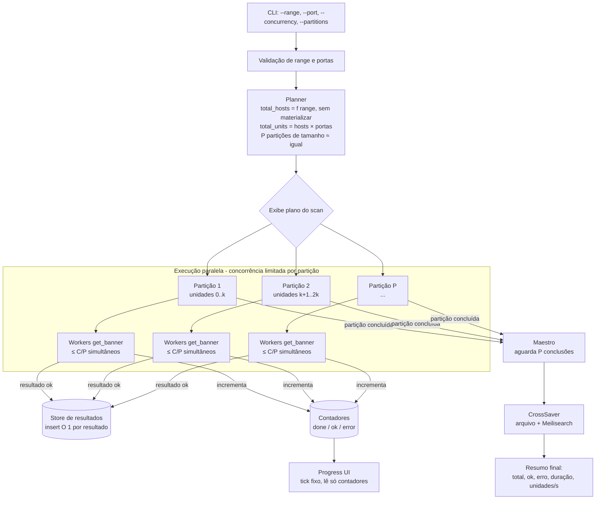
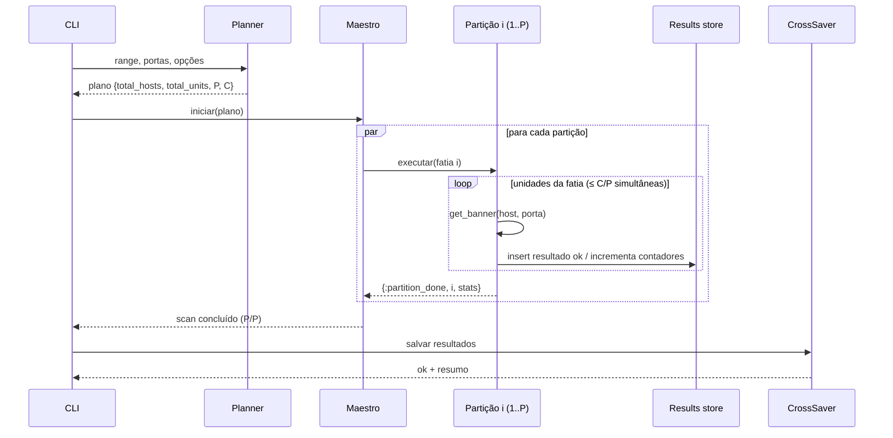

# Specification: Scan paralelo particionado (chunked) com agregação eficiente de resultados

## 1. Objective

Hoje o Binoculo recebe um range/CIDR (ex.: `/16` = 65.536 hosts), itera host a host e, para cada combinação `host:porta`, dispara um worker. O resultado é coletado pelo `Maestro` e mantido em ETS até o fim do scan, quando é salvo em arquivo e no Meilisearch.

O objetivo é **reduzir o tempo total de scans grandes** (≥ `/16`) e tornar o throughput **previsível e configurável**, sem perda de resultados. Para isso:

- o trabalho total (`hosts × portas`) é calculado **antes** do início do scan;
- esse trabalho é dividido em **partições (chunks) de tamanho aproximadamente igual**, processadas em paralelo por workers independentes;
- cada partição respeita um limite de concorrência real (conexões simultâneas);
- os resultados são agregados de forma incremental, com custo constante por resultado, em vez de passarem por um único ponto serializado.

### Diagnóstico do estado atual (contexto que motiva a mudança)

Análise de `Binoculo.Maestro`, `Binoculo.Results` e `Binoculo.init_cli/1`:

| # | Observação | Efeito |
|---|------------|--------|
| D1 | `Task.async_stream(..., max_concurrency: 200)` só limita a chamada a `GenServer.cast`. O trabalho real roda em `Task.async` dentro do `Maestro`, **sem nenhum limite**. | Na prática a concorrência é ilimitada. Em ranges grandes o stream esvazia quase na hora e o Maestro dispara `hosts × portas` tasks de uma vez. **[Assumption]** Isso pode estourar o limite de file descriptors (`emfile`) e de portas efêmeras. Essas falhas viram `:error` e são descartadas em silêncio, o que causa falsos negativos. |
| D2 | Todo start (`cast`) e todo resultado (`handle_info`, mais a mensagem `:DOWN` de cada task) passam pela **mailbox de um único GenServer**. | Ponto único de serialização. A latência de coleta cresce com o tamanho do scan. |
| D3 | `Results.add_item/1`, `finish_item/1` e `remove_item/1` leem a **lista inteira** do ETS, alteram e regravam. `remove_item` ainda filtra a lista toda. | Custo O(n) por operação, ou seja, O(n²) no scan inteiro. Em `/16 × N portas` isso domina o tempo de CPU. |
| D4 | `remove_item/1` filtra só por `host`, ignorando a porta. | Concluir `host:80` remove da lista "running" todas as portas daquele host. O estado intermediário fica inconsistente, embora o contador continue correto. |
| D5 | `progress/0` é um loop sem pausa que chama `get_state/0` duas vezes por iteração. `get_state/0` copia para o processo as listas `running` e `finished` inteiras. | Busy-loop que compete por CPU com os workers e copia megabytes a cada iteração. |
| D6 | `qty_to_run` é calculado com `Enum.to_list(range) \|> Enum.count()`, materializando o range inteiro. | Alocação desnecessária. O valor pode ser calculado de forma aritmética. |
| D7 | `wait_for_workers/0` espera até que `qty_running > 0`. | Se todos os workers terminarem antes da primeira checagem (range pequeno ou tudo dando erro rápido), o CLI fica preso para sempre. |
| D8 | O tempo de cada unidade é limitado por `connect timeout (2s) + recv timeout (2s)`. | O throughput teórico é `concorrência ÷ latência média`. **Dividir em chunks sozinho não acelera.** O ganho vem de concorrência real e controlada (D1) e de tirar o gargalo da coleta (D2, D3, D5). |

Conclusão: chunking é a forma de **organizar** o paralelismo (balanceamento, limite por partição, agregação local). A aceleração vem de eliminar a serialização e o custo quadrático da coleta e de controlar a concorrência efetiva.

## 2. Expected behavior

- Antes de iniciar, o Binoculo exibe o plano do scan: total de hosts, total de portas, total de unidades (`hosts × portas`), número de partições e concorrência efetiva.
- O total de hosts é calculado sem materializar o range, para CIDR (`/0`–`/32`), ranges `a..b` e IP único.
- O trabalho é dividido em `P` partições contíguas. A diferença de tamanho entre a maior e a menor partição é de **no máximo 1 unidade**.
- Cada partição é processada por um worker de partição independente, que respeita um limite de conexões simultâneas.
- A concorrência global efetiva (soma das partições) nunca passa do limite configurado.
- Os resultados de sucesso são entregues ao agregador (Maestro ou equivalente) com custo constante por resultado. Não existe operação O(n) sobre o conjunto de resultados durante o scan.
- O progresso é exibido a partir de contadores (concluídos / total), atualizado em intervalo fixo, sem copiar listas de resultados.
- O scan termina quando todas as unidades foram processadas, inclusive quando todas falham ou o range tem um único host.
- O conteúdo final salvo (arquivo e Meilisearch) é **equivalente** ao comportamento atual, com o mesmo conjunto de `host:porta` com banner e o mesmo formato de saída. A ordem pode mudar.
- A falha de uma partição (crash) não derruba as outras. Ela é reportada no resumo final com a quantidade de unidades não processadas.
- Parâmetros de paralelismo têm defaults sensatos e podem ser sobrescritos pelo usuário (ver seção 5).

## 3. Main flow

```
Input (range + portas) → Validação → Planejamento (contagem + particionamento)
→ Execução paralela por partição (concorrência limitada)
→ Agregação incremental de resultados + contadores de progresso
→ Finalização (todas as partições concluídas) → Persistência (arquivo / Meilisearch) → Resumo
```





## 4. Acceptance criteria

```gherkin
Feature: Scan paralelo particionado

  Scenario: Success - Plano calculado sem materializar o range
    Given o range "10.0.0.0/16" e as portas "80,443"
    When o Binoculo planeja o scan
    Then o total de hosts informado é 65536
    And o total de unidades informado é 131072
    And o plano é exibido antes do início do scan

  Scenario: Success - Particionamento balanceado
    Given um total de 131072 unidades e 8 partições
    When o trabalho é dividido
    Then existem exatamente 8 partições
    And a soma das unidades das partições é 131072
    And a diferença entre a maior e a menor partição é no máximo 1
    And nenhuma unidade aparece em mais de uma partição

  Scenario: Success - Mais partições do que unidades
    Given o range "192.168.0.1" (1 host), a porta "80" e 8 partições solicitadas
    When o trabalho é dividido
    Then o número de partições efetivas é 1
    And nenhuma partição vazia é executada

  Scenario: Success - Concorrência efetiva limitada
    Given o limite de concorrência configurado em 500
    When um scan de "10.0.0.0/16" com 2 portas está em execução
    Then em nenhum momento existem mais de 500 conexões de banner em andamento

  Scenario: Success - Resultado equivalente ao comportamento atual
    Given um ambiente de teste com serviços escutando em host:porta conhecidos
    When o scan é executado com 1 partição e depois com N partições
    Then o conjunto de host:porta com banner salvo é idêntico nas duas execuções
    And o formato de cada registro no arquivo de saída não muda

  Scenario: Success - Múltiplas portas do mesmo host
    Given um host com as portas 80 e 22 abertas
    When o scan das duas portas é concluído
    Then ambos os resultados são salvos
    And o progresso contabiliza 2 unidades concluídas

  Scenario: Success - Progresso por contadores
    Given um scan em andamento
    When o progresso é exibido
    Then ele mostra unidades concluídas / total e é atualizado em intervalo fixo
    And a exibição do progresso não lê a lista de resultados

  Scenario: Success - Medição de tempo do scan
    Given um scan qualquer
    When o scan inicia
    Then o horário de início é exibido
    When o scan e a persistência terminam
    Then são exibidos o horário de fim, a duração da fase de scan, a duração da persistência, a duração total e unidades/s

  Scenario: Error - Todas as unidades falham rapidamente
    Given um range onde nenhum host responde e connect falha imediatamente
    When o scan é executado
    Then o Binoculo termina normalmente
    And o resumo informa 0 sucessos e o total de erros

  Scenario: Error - Falha de uma partição
    Given um scan com 4 partições
    When uma partição termina com crash
    Then as outras 3 partições continuam e concluem
    And os resultados já coletados são salvos
    And o resumo informa quantas unidades não foram processadas

  Scenario: Error - Parâmetros inválidos
    Given o usuário informa "--concurrency 0" ou "--partitions -1"
    When os argumentos são validados
    Then o Binoculo recusa a execução com mensagem de erro clara
```

## 5. Contracts and constraints

### CLI (contrato existente: compatível, só com adições)

- `--range` e `--port` não mudam.
- **[Assumption]** Novas opções, todas opcionais:
  - `--concurrency <int>`: limite global de conexões simultâneas. Default proposto: `5000`. O valor atual de `200` não é respeitado de fato (D1). Como a maioria dos hosts de um range grande não responde e consome o timeout inteiro, um default baixo (ex.: 500) deixaria o scan **mais lento** que o comportamento atual sem limite. O default final deve ser escolhido a partir do benchmark.
  - `--partitions <int>`: número de partições. Default proposto: `System.schedulers_online()`.
  - `--timeout <ms>`: timeout de connect/recv por unidade. Default `2000`, igual ao atual.
- Se nenhuma opção nova for informada, o comportamento observável (o que é salvo) segue igual ao de hoje.

### Saída / persistência

- O formato do arquivo em `output/<file>` (template de `Util.host_info_to_text_template/1`) não muda.
- O documento enviado ao Meilisearch (índice `hosts`) e o `id` (md5 de `host <> port`) não mudam.
- O filtro `--read` continua aplicado antes da persistência.

### API HTTP (`POST /scan`)

- Fora do escopo desta entrega (ver seção 6). Sem mudança de contrato.

### Performance

- Custo de agregação por resultado: **O(1) amortizado**. Não pode haver leitura e regravação da coleção inteira por resultado.
- O progresso não pode copiar a coleção de resultados. A frequência de atualização é fixa (ex.: ≤ 10 Hz).
- O planejamento (contagem + particionamento) de um `/8` com 10 portas termina em menos de 100 ms e usa memória O(P), não O(hosts).
- **[Assumption]** Meta de referência: em um `/16 × 2 portas` com a maioria dos hosts sem resposta, a fase de scan deve se aproximar de `ceil(unidades / concorrência) × latência média` (± 20%), dominada pela rede e não pela coleta. Exemplo: 131.072 unidades com C = 5000 e ~2–4s por unidade sem resposta dá ~27 lotes, ou seja, ~1–2 min.
- Uso de file descriptors limitado pela concorrência configurada. Se `--concurrency` for maior que o `ulimit -n` disponível, o Binoculo avisa antes de iniciar.

#### Baseline de referência (motor atual)

Cenário real usado para comparar antes e depois:

```bash
./binoculo --range 177.67.56.60/16 -p 22 --output <arquivo>.txt
```

| Métrica | Valor |
|---|---|
| Unidades | 65.536 hosts × 1 porta = 65.536 |
| Início | 2026-11-05 13:44:45 -03 |
| Ainda em execução em | 2026-11-05 14:02:59 -03 (~18 min decorridos) |
| Fim / duração total | 2026-11-05 ~14:11:30 -03 (arquivo de saída gravado) → **~26m45s** (scan + persistência, sem separação) |
| Throughput observado | ~41 unidades/s (65.536 ÷ 1.605 s) |

Medição do motor novo (1.4.0), **apenas loopback** (`127.0.0.1/16`, porta fechada, 24 partições, concorrência 5000), para isolar o custo de coordenação/coleta. Não é comparável a um scan de internet, onde a latência de rede domina:

| Versão | Duração (scan) | Throughput |
|---|---|---|
| 1.3.1 (antiga) | não terminou em 200 s (cancelado) | n/a |
| 1.4.0 (nova) | 1,1–2,1 s | 30.000–57.000 unidades/s |

O benchmark real (mesmo comando da baseline acima, contra a rede alvo) fica pendente para o autor rodar com `./binoculo ... --output ...` e comparar com os ~26m45s.

Estimativa para o mesmo cenário depois da mudança, limitada pela rede: `65.536 / 5000 ≈ 14 lotes × ~2–4s ≈ 30–60s` de fase de scan. **[Assumption]** Isso depende de `ulimit -n`, do limite de portas efêmeras e da rede do host.

### Observabilidade

- Plano exibido no início: `started_at` (data/hora local, ISO 8601), `total_hosts`, `ports`, `total_units`, `partitions`, `concurrency`, `timeout`.
- Resumo exibido no fim: `started_at`, `finished_at`, duração total legível (ex.: `3m 42.1s`), `ok`, `error`, `not_processed` e unidades/s.
- A duração é separada em **fase de scan** (do início até a última unidade) e **fase de persistência** (arquivo + Meilisearch), para isolar onde o tempo é gasto.
- A duração usa relógio monotônico (não é afetada por ajustes do relógio do sistema). `started_at` e `finished_at` usam o relógio de parede.
- **Pré-requisito:** a medição de tempo deve ser entregue **antes** das mudanças de performance, para registrar a baseline do motor atual.
- Erros de recurso (`emfile`, `eaddrnotavail`) contados separadamente de "host não respondeu", para não mascarar falsos negativos.

### Correção

- Cada unidade `host:porta` é processada exatamente uma vez (sem duplicata nem omissão), exceto em caso de crash de partição, que é reportado.
- O término do scan é detectado de forma determinística, sem depender de `qty_running > 0` em algum instante (D7).

## 6. Out of scope

- Unificar o motor de scan da API HTTP (`Binoculo.Api.Service.get_banners/5`) com o novo motor particionado. Pode ser feito depois, aproveitando o mesmo planner.
- Distribuição entre múltiplos nós BEAM / máquinas (cluster).
- Persistência incremental em streaming (salvar no arquivo/Meilisearch durante o scan). Ganho real, mas é outra entrega.
- Scan SYN/raw socket ou técnicas stateless (estilo masscan/zmap).
- Retry de unidades que falharam.
- Mudanças no dashboard ou no formato do índice do Meilisearch.
- Suporte a IPv6.

## 7. Definition of Done

- [ ] Critérios de aceite satisfeitos.
- [ ] Testes unitários do planner: contagem para CIDR, range `a..b` e IP único; balanceamento (diferença ≤ 1, soma correta, sem sobreposição); `P > unidades`.
- [ ] Teste de integração com servidores TCP locais (stub) validando equivalência de resultados entre 1 e N partições e múltiplas portas por host.
- [ ] Teste garantindo que a concorrência efetiva não passa do limite configurado.
- [ ] Teste de término com 100% de falhas (sem travar).
- [ ] `test/maestro_test.disabled` reativado ou substituído por testes equivalentes.
- [ ] `mix test`, `mix format --check-formatted` e `mix credo` (se configurado) passando.
- [ ] Baseline medida com o motor atual (já com início, fim e duração) e benchmark depois da mudança documentado (ex.: `/20` e `/16` com 2 portas), com duração da fase de scan, duração da persistência e unidades/s.
- [ ] README atualizado com as novas opções de CLI e recomendação de `ulimit -n`.
